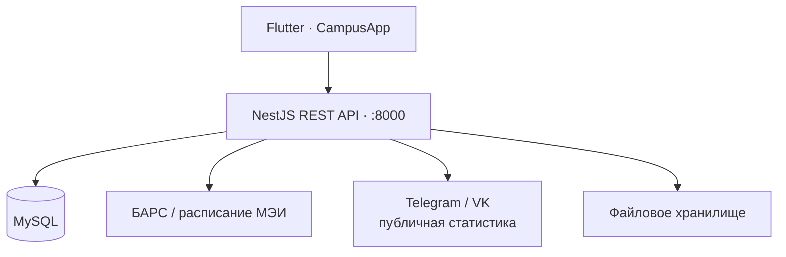

<p align="center">
  <picture>
    <source media="(prefers-color-scheme: dark)" srcset="https://raw.githubusercontent.com/Agarych-ilya/CampusApp/main/assets/images/logo/logo_main_dark.png">
    
  </picture>
</p>

<h1 align="center">Campus Backend</h1>
<p align="center">
  <strong>Серверная основа студенческого CampusApp</strong><br>
  API для расписания, БАРС, сообществ, объявлений, учебных наборов и облачных файлов.
</p>

<p align="center">
  <a href="https://nestjs.com/"></a>
  <a href="https://www.typescriptlang.org/"></a>
  <a href="https://www.mysql.com/"></a>
  <a href="#основные-маршруты"></a>
</p>

<p align="center">
  <a href="#быстрый-старт">Быстрый старт</a> ·
  <a href="#основные-маршруты">Маршруты</a> ·
  <a href="#авторизация-и-безопасность">Авторизация</a> ·
  <a href="#тесты">Тесты</a> ·
  <a href="https://github.com/Agarych-ilya/CampusApp">Flutter-клиент ↗</a>
</p>

---

> [!NOTE]
> Актуальная серверная разработка ведётся в ветке **[feature/cloud](https://github.com/Agarych-ilya/Campus-backend/tree/feature/cloud)**. Маркет, публичные наборы и новые функции сообществ документированы для этой ветки и могут отсутствовать в текущем коде `main`. Клиент: **[features/services-screen](https://github.com/Agarych-ilya/CampusApp/tree/features/services-screen)**.

## ⚙️ За что отвечает сервер

| Модуль | Назначение |
|:--|:--|
| 📅 **Schedule** | Расписание студенческих групп и обращение к источникам данных МЭИ. |
| 🔑 **Auth / BARS** | Аутентификация, сессии и проверка существующих сессий БАРС. |
| 👥 **Communities** | Каталог, заявки, модерация, аватарки и публичная численность участников. |
| 🛒 **Listings** | Маркет и бюро находок: объявления, изображения, изменение статуса и жалобы. |
| 🧠 **Study** | Публикация общих наборов Campus Cards, поиск и рейтинг. |
| ☁️ **File** | Загрузка, список, получение и удаление файлов. |

<a id="быстрый-старт"></a>
## 🚀 Быстрый старт

**Требования:** Git, Node.js LTS (совместимый с NestJS 11), npm и MySQL.

### 1 · Скачать проект

```powershell
git clone https://github.com/Agarych-ilya/Campus-backend.git
cd Campus-backend
git switch feature/cloud
npm ci
```

### 2 · Подготовить MySQL

Создай отдельную базу данных, например через MySQL CLI:

```sql
CREATE DATABASE IF NOT EXISTS campus_db
  CHARACTER SET utf8mb4
  COLLATE utf8mb4_unicode_ci;
```

Настрой пользователя MySQL и его права. Часть таблиц сервисы создают при первом обращении. Если у пользователя БД нет права `CREATE TABLE`, подготовь схему заранее. SQL-файлы в `migrations/` покрывают базовые таблицы пользователей и сообществ, **но не все схемы новых сервисов**.

### 3 · Настроить окружение

```powershell
Copy-Item .env.example .env
notepad .env
```

Пример локальных настроек **без реальных секретов**:

```dotenv
PORT=8000
DB_HOST=localhost
DB_PORT=3306
DB_USER=campus_user
DB_PASSWORD=YOUR_LOCAL_DB_PASSWORD
DB_NAME=campus_db

# Всегда используй длинный случайный секрет:
SESSION_SECRET=REPLACE_WITH_RANDOM_SECRET_AT_LEAST_32_CHARACTERS

# Для HTTP через локальный ADB Reverse:
COOKIE_SECURE=false

# Необязательный список модераторов с проверенной зачёткой БАРС:
COMMUNITY_ADMIN_BARS_RECORD_BOOKS=
```

Полный перечень параметров — в **[.env.example](https://github.com/Agarych-ilya/Campus-backend/blob/feature/cloud/.env.example)**.

Генерация секрета сессии в Windows PowerShell:

```powershell
$bytes = New-Object byte[] 48
$rng = [System.Security.Cryptography.RandomNumberGenerator]::Create()
$rng.GetBytes($bytes)
[Convert]::ToBase64String($bytes)
$rng.Dispose()
```

Файл `.env` исключён из Git. Не добавляй туда реальные секреты, которые затем попадут в коммиты или скриншоты.

### 4 · Запустить API

```powershell
npm run start:dev
```

В другом терминале:

```powershell
curl.exe http://127.0.0.1:8000/health
# {"status":"ok"}
```

Сервер использует порт **8000** по умолчанию или значение `PORT` из `.env`.

<a id="основные-маршруты"></a>
## 🧭 Основные маршруты

| Метод | Маршрут | Назначение |
|:--|:--|:--|
| `GET` | `/health` | Проверка доступности API |
| `GET` | `/schedule` | Расписание по группе и дате |
| `POST` | `/auth/register` | Регистрация в backend |
| `POST` | `/auth/login` | Вход в backend |
| `GET` | `/file` | Список файлов |
| `POST` | `/file/upload` | Загрузка файла |
| `GET` | `/file/:id/download` | Получение файла |
| `GET` | `/services/groups` | Каталог сообществ |
| `POST` | `/services/groups/submissions` | Новая заявка |
| `GET` | `/services/listings` | Маркет / бюро находок |
| `POST` | `/services/listings` | Публикация объявления |
| `GET` | `/services/study/decks` | Общие учебные наборы |
| `POST` | `/services/study/decks` | Публикация набора |
| `POST` | `/services/study/decks/:id/rating` | Оценка 1–5 звёзд |

Изменение и удаление чужих объявлений и наборов ограничено сервером. Модерация сообществ использует защищённые маршруты `/services/admin/...`. Форматы тел запросов — в контроллерах внутри `src/`.

<details>
<summary><b>Примеры GET-запросов</b></summary>

```powershell
curl.exe "http://127.0.0.1:8000/schedule?group=YOUR_GROUP&date=2026-11-08"
curl.exe "http://127.0.0.1:8000/services/groups"
curl.exe "http://127.0.0.1:8000/services/study/decks"
```

Вместо `YOUR_GROUP` укажи настоящую группу. `/health` проверяет доступность самого API, но не гарантирует работу внешнего источника расписания.

</details>

<a id="архитектура"></a>
## 🏗️ Архитектура



```text
src/
├── auth/                 # Регистрация и сессии
├── bars/                 # Интеграция с БАРС
├── schedule/             # Расписание
├── file/                 # Файлы
├── services/
│   ├── admin/            # Проверка БАРС и модерация
│   ├── listings/         # Объявления и фотографии
│   ├── study/            # Публичные наборы и рейтинги
│   ├── services.controller.ts
│   └── services.module.ts
├── db.service.ts         # Пул соединений MySQL
├── app.module.ts         # Корневой модуль
└── main.ts               # CORS, сессии, запуск
migrations/               # Базовые SQL-миграции
```

<a id="авторизация-и-безопасность"></a>
## 🔐 Авторизация и безопасность

**Модерация.** Клиент использует уже действующую сессию БАРС студента. Backend самостоятельно сверяет данные из БАРС с разрешёнными номерами зачётных книжек в `COMMUNITY_ADMIN_BARS_RECORD_BOOKS`. Присланные телефоном ФИО и номер зачётки сами по себе не дают права администратора.

**Публикации.** Создание и изменение объявлений, публикация наборов и оценки используют серверную проверку подтверждённого пользователя. Собственный учебный набор оценивать нельзя; на чужой набор приходится одна обновляемая оценка пользователя.

> [!IMPORTANT]
> Cookie БАРС передавай только доверенному backend по **HTTPS** либо локально через **ADB Reverse → 127.0.0.1**. В продакшене необходимы TLS, `COOKIE_SECURE=true`, безопасное хранилище сессий и отдельный MySQL-пользователь с минимальными правами. `COOKIE_SECURE=false` подходит только для локальной разработки.

| Переменная | Для чего |
|:--|:--|
| `DB_HOST`, `DB_PORT`, `DB_USER`, `DB_PASSWORD`, `DB_NAME` | Подключение к MySQL |
| `SESSION_SECRET` | Подпись сессий; для администрирования минимум 32 символа |
| `COOKIE_SECURE` | Передача cookie только по HTTPS |
| `COMMUNITY_ADMIN_BARS_RECORD_BOOKS` | Разрешённые номера зачётных книжек модераторов |
| `CORS_ALLOWED_ORIGINS` | Разрешённые веб-источники |
| `TELEGRAM_BOT_TOKEN`, `VK_ACCESS_TOKEN` | Необязательные интеграции для статистики групп |

<a id="тесты"></a>
## 🧪 Тесты

```powershell
npm run build
npm test -- --runInBand

# Выборочные тесты
npx jest study-public.service.spec.ts --runInBand
npx jest listings.service.spec.ts --runInBand
npx jest bars-session-verifier.service.spec.ts --runInBand
```

Команды предназначены для локальной проверки и не означают, что в репозитории уже настроен CI.

## 📱 Подключение Flutter

После запуска API на компьютере:

```powershell
& "$env:LOCALAPPDATA\Android\Sdk\platform-tools\adb.exe" -s emulator-5554 reverse tcp:8000 tcp:8000
```

В каталоге Flutter-клиента:

```powershell
flutter run -d emulator-5554 --dart-define=CAMPUS_API_BASE_URL=http://127.0.0.1:8000
```

Для телефона по USB подставь его ID из `flutter devices`. Подробнее — в **[README клиента](https://github.com/Agarych-ilya/CampusApp/blob/features/services-screen/README.md#быстрый-старт)**.

## 🧱 Статус проекта

Сервер активно развивается. Интеграции БАРС, расписания и публичных страниц Telegram/VK зависят от сторонних источников и могут требовать адаптации. Эксперименты на Python находятся в `old_backend_python/`; основной сервер написан на NestJS.

---

<div align="center">
  <b>Campus Backend</b> · API для студенческого CampusApp<br>
  <sub><a href="https://github.com/Agarych-ilya/CampusApp">Flutter-клиент</a> · <a href="https://github.com/Agarych-ilya/Campus-backend">Исходный код сервера</a></sub>
</div>